# ⚡ Autonomous Serverless CI Backend Architecture (ThePopeBot Pattern)

> **Zero Hosting Costs · 24/7 Autonomous Market Execution · Git-as-a-Database · Guarded Bidding Dispatch**

This system adapts the autonomous AI worker architecture pioneered by [Stephen G. Pope's `thepopebot`](https://github.com/stephengpope/thepopebot) to run an institutional-grade liquidation terminal for **$0.00 / month forever**.

---

## 🏛️ Architecture Overview

Rather than paying for an always-on cloud virtual machine (e.g. AWS EC2, GCP Compute Engine, DigitalOcean Droplet), **GitHub Actions** and **GitLab CI** are leveraged as an ephemeral serverless backend compute engine.

```mermaid
flowchart TD
    subgraph TriggerLayer["1. Trigger & Event Layer (Free)"]
        Cron["Cron Schedule (e.g. every 2 hours)"]
        Dispatch["Workflow Dispatch (Manual UI / Web Console)"]
        Webhook["Repository Dispatch / GitLab Webhook"]
    end

    subgraph ComputeLayer["2. Ephemeral Compute Runners (Free Tier)"]
        GHA["GitHub Actions Runner (ubuntu-latest, 2k-3k min/mo free)"]
        GLC["GitLab CI Runner (node:24 Docker, 400 min/mo free)"]
    end

    subgraph EngineLayer["3. Autonomous Engine (scripts/ci-backend.mjs)"]
        Scrapling["Scrapling Stealth Browser & Cloudflare Turnstile Solver"]
        Crawler["B-Stock Multi-Market Auction Crawler"]
        Funnel["4-Stage Mathematical Funnel Engine (Alpha Gems)"]
        Kelly["Kelly-Criterion Capital Allocator"]
    end

    subgraph StateLayer["4. Multi-Tier Free State Persistence"]
        GitDB["Git-as-a-Database (public/data/*.json, backups/bstock.db)"]
        Firestore["Cloud Firestore (Spark Plan: 50k reads, 20k writes/day free)"]
        CloudStorage["Firebase Cloud Storage (5 GB storage free)"]
        GHSummary["GitHub Actions Step Summary (Rich Markdown Reports)"]
    end

    subgraph PresentationLayer["5. Zero-Cost Frontend Hosting"]
        GHPages["GitHub Pages (100% Free Static Hosting)"]
        GLPages["GitLab Pages (100% Free Static Hosting)"]
        NetlifyLambda["Netlify Functions (125k free serverless calls/mo)"]
    end

    TriggerLayer --> ComputeLayer
    ComputeLayer --> EngineLayer
    EngineLayer --> StateLayer
    StateLayer --> PresentationLayer
```



---

## 💰 Zero-Cost Infrastructure Matrix

| Service | Role | Free Tier Quota | Monthly Cost |
| :--- | :--- | :--- | :---: |
| **GitHub Actions** | Autonomous market crawler & bid executor | 2,000 min/mo (Private) / **Unlimited** (Public) | **$0.00** |
| **GitLab CI** | Secondary redundant runner & schedule backup | 400 CI minutes/mo | **$0.00** |
| **Firebase Cloud Firestore** | Real-time lot storage & audit ledger | 50,000 reads/day, 20,000 writes/day | **$0.00** |
| **Firebase Cloud Storage** | Image cache & SQLite database backups | 5 GB storage, 1 GB transfer/day | **$0.00** |
| **GitHub Pages** | Static ops dashboard & client console | 100 GB bandwidth/mo, 10 builds/hr | **$0.00** |
| **GitLab Pages** | Live ops dashboard mirror | Free unlimited static sites | **$0.00** |
| **Total** | **End-to-End Enterprise Terminal** | **Zero Infrastructure Overhead** | **$0.00 / mo** |

---

## ⚙️ Workflows Inventory

### 1. Market Backend Worker (`.github/workflows/market-backend.yml`)
- **Triggers:**
  - `schedule`: Cron `0 */2 * * *` (runs every 2 hours).
  - `workflow_dispatch`: Manual execution with parameters:
    - `mode`: `"mock"` or `"live"`
    - `pages`: e.g. `"5"` (80 lots/page = 400 lots)
    - `solve_clearance`: `true` / `false`
    - `sync_firebase`: `true` / `false`
    - `commit_data`: `true` / `false`
  - `repository_dispatch`: Webhook events `[market-crawl, trigger-sync]`
- **Action Sequence:**
  1. Spins up `ubuntu-latest` (1x billing multiplier, 0 cost).
  2. Bootstraps Node 24 and Python 3.12 with lockfile dependency caching.
  3. Solves Cloudflare challenge using Scrapling stealth browser if live clearance is absent.
  4. Ingests auctions, computes 4-stage auction funnel metrics, and identifies Alpha Gems.
  5. Commits `public/data/listings.json`, `public/data/status.json`, `public/data/summary.md`, and `backups/bstock.db` back to the git repo with `[skip ci]`.
  6. Replicates snapshots and SQLite database to Cloud Firestore and Cloud Storage.
  7. Emits a rich Markdown table into `$GITHUB_STEP_SUMMARY`.

### 2. Guarded Bidding Dispatch (`.github/workflows/bid-dispatch.yml`)
- **Triggers:** `workflow_dispatch` (Operator manual control) or `repository_dispatch` (API webhook).
- **Parameters:**
  - `listing_id`: Lot or Listing ID (e.g. `mock000045` or live UUID).
  - `amount`: Maximum hammer bid ceiling in USD.
  - `dry_run`: `true` (default simulation) or `false`.
  - `armed`: `true` (explicit operator confirmation) or `false`.
  - `note`: Audit rationale memo.
- **Safeguard Verification:**
  - Checks daily exposure cap, per-bid cap, min quality score floor, and target ROI ceiling.
  - Signs execution plan cryptographically using HMAC-SHA256 (`PlanSigner`).
  - Appends signed execution receipt to `audit/bid-ledger.jsonl`.
  - Commits audit ledger back to Git repository and syncs to Firestore collection `bids`.
  - Renders complete execution ticket in `$GITHUB_STEP_SUMMARY`.

### 3. GitHub Pages Deployment (`.github/workflows/deploy-pages.yml`)
- **Triggers:**
  - Push to `main` (paths in `apps/web/**`, `public/**`, `packages/**`).
  - Automatic trigger upon completion of `Market Backend Engine` (`workflow_run`).
  - `workflow_dispatch`.
- **Result:** Builds React 19 + TypeScript SPA and deploys static assets with client-side SPA routing (`404.html` fallback).

### 4. Continuous Integration Test Suite (`.github/workflows/test.yml`)
- **Triggers:** Pull requests and pushes to `main`.
- **Guarantees:** Verifies zero regressions, TypeScript typechecking, and 100% test pass rate across 45 Vitest tests in <60 seconds.

### 5. GitLab CI Pipeline (`.gitlab-ci.yml`)
- **Pipeline Sources:** Schedule, trigger webhook, web UI, or git push.
- **Stages:** `test`, `market`, `build`, `deploy`.
- **GitLab Pages:** Automatically deployed to `https://bstock-command-d1fcc3.gitlab.io`.

---

## 🔐 Required Secrets Configuration

To enable live crawling and Firebase synchronization, configure the following secrets in **GitHub (Settings > Secrets and variables > Actions)** or **GitLab (Settings > CI/CD > Variables)**:

| Secret Name | Description | Required For |
| :--- | :--- | :--- |
| `BSTOCK_CLEARANCE` | Cloudflare `cf_clearance` cookie token | Live B-Stock search & auctions |
| `BSTOCK_UA` | User-Agent string matching clearance cookie | Live B-Stock API calls |
| `BSTOCK_LOGIN_ID` | B-Stock account email address | Automatic token authentication |
| `BSTOCK_PASSWORD` | B-Stock account password | Automatic token authentication |
| `BSTOCK_TOKEN` | Bearer access token (if available) | Live authenticated queries & bids |
| `FIREBASE_PROJECT_ID` | GCP / Firebase project ID | Firestore & Storage sync |
| `FIREBASE_STORAGE_BUCKET`| Cloud Storage bucket (e.g. `colab-plugin.appspot.com`)| Image cache & DB backups |
| `FIREBASE_SERVICE_ACCOUNT`| Service Account JSON key string | Serverless Firestore/Storage admin auth |
| `GITLAB_ACCESS_TOKEN` | Project Access Token with `write_repository` | GitLab Git-as-a-database commits |

*Note: If no live secrets are configured, the system automatically runs against the built-in realistic mock system without throwing errors.*

---

## 🕹️ Operator Web Console Integration

The web application (`apps/web`) includes a built-in **Autonomous CI Backend Modal**:
1. Click the **`CI: Free Backend ⚡`** pill in the topbar status cluster.
2. View current data snapshot age and opportunity tier breakdown.
3. Store your GitHub Personal Access Token (`ghp_...`) or GitLab Trigger Token safely in browser `localStorage`.
4. Dispatch an immediate crawl run on GitHub Actions or GitLab CI with one click!
5. Directly link to GitHub Actions and GitLab CI pipeline run logs.

---

## 🏃 Local Execution Commands

You can run the exact same CI scripts locally at any time:

```bash
# 1. Run full market crawl & mathematical funnel engine
npm run ci:crawl

# 2. Run crawl with live credentials & Firebase sync
FIREBASE_SYNC=1 node scripts/ci-backend.mjs --live --solve-clearance

# 3. Simulate guarded bid dispatch
npm run ci:bid -- --lot-id mock000045 --amount 650

# 4. Run test suite
npm test

# 5. Build full production web distribution
npm run build
```
